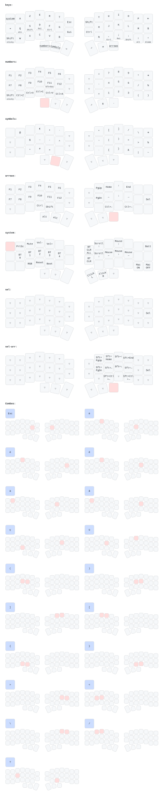

# Corne Choc Pro config (Français)

## My Keyboard
- Keyboard: Corne Choc Pro Bluetooth from [Keebart](https://keebart.com/)
- 46 keys
- no screen
- no rotary encoder
- board: nRF52840 M.2 Module (nrf52840_m2)

## Building

GitHub Actions builds the firmware on every push that changes the config, board or behaviors (download it from the run's artifacts).
To build on your own machine with podman/docker, see [docs/building-locally.md](docs/building-locally.md).

## My layout 

Change the layout with the [online keymap editor](https://nickcoutsos.github.io/keymap-editor/)

The drawing is regenerated by CI ([keymap-drawer](https://github.com/caksoylar/keymap-drawer), `.github/workflows/draw.yml`) on every keymap change on `main`, with AZERTY legends from `keymap_drawer.config.yaml`. The mac layers are not drawn.
