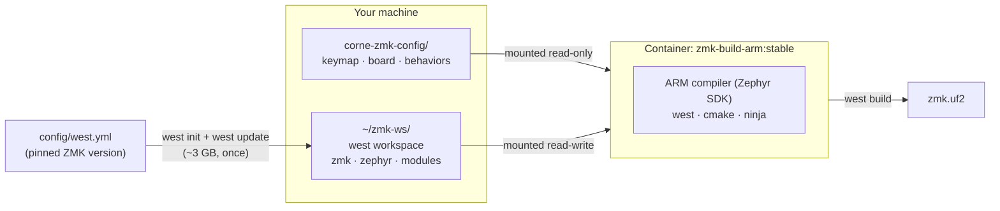
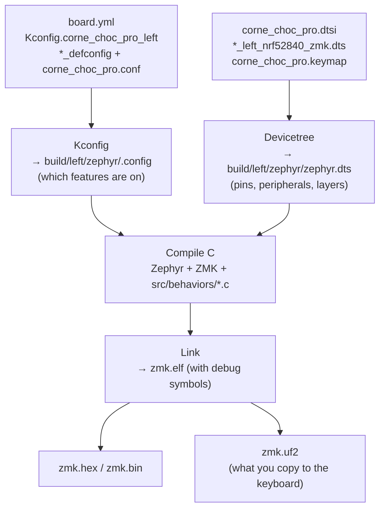
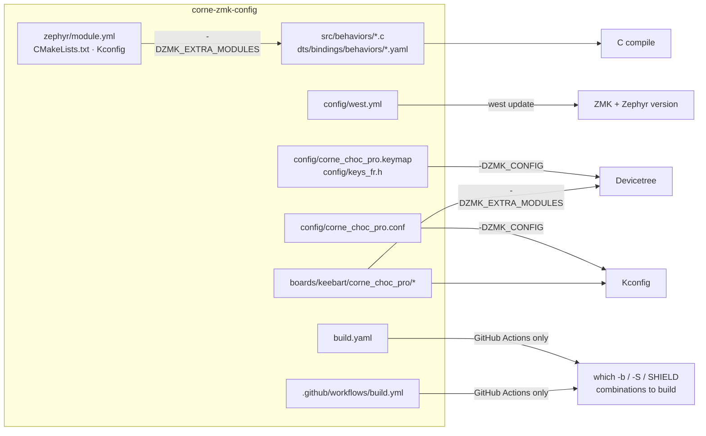
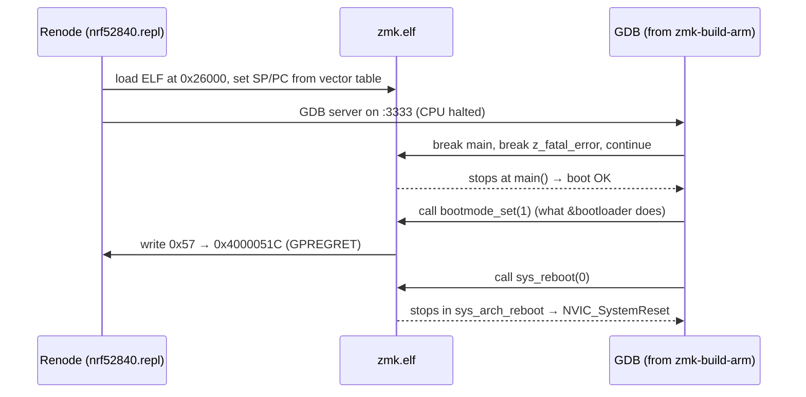

# Building the firmware locally

How to build the `.uf2` files on your own machine instead of waiting for GitHub Actions, what
each step does, and how to check the result before flashing.

Official ZMK docs, for reference:
[toolchain setup](https://zmk.dev/docs/development/local-toolchain/setup) ·
[building and flashing](https://zmk.dev/docs/development/local-toolchain/build-flash).

---

## TL;DR

On the host (fish or bash both work):

```bash
mkdir -p ~/zmk-ws
podman run -it --rm \
  -v ~/zmk-ws:/ws:Z \
  -v ~/sources/corne-zmk-config:/ws/zmk-config:ro,Z \
  docker.io/zmkfirmware/zmk-build-arm:stable bash
```

Inside the container:

```bash
cd /ws
rm -rf config && cp -r zmk-config/config config
[ -d .west ] || west init -l config
west update
west zephyr-export

west build -p -s zmk/app -d build/left  -b corne_choc_pro_left//zmk  -S studio-rpc-usb-uart -- -DZMK_CONFIG=/ws/config -DZMK_EXTRA_MODULES=/ws/zmk-config
west build -p -s zmk/app -d build/right -b corne_choc_pro_right//zmk                         -- -DZMK_CONFIG=/ws/config -DZMK_EXTRA_MODULES=/ws/zmk-config
```

Results on the host:

```text
~/zmk-ws/build/left/zephyr/zmk.uf2
~/zmk-ws/build/right/zephyr/zmk.uf2
```

`docker` works the same as `podman` in every command here.

---

## The three ingredients



| Ingredient | What it is | Where it comes from |
|---|---|---|
| **Container** `zmkfirmware/zmk-build-arm:stable` | The whole toolchain: `arm-zephyr-eabi-gcc`, `west`, `cmake`, `ninja`, Python deps. Nothing to install on the host. | Docker Hub. GitHub Actions uses the exact same image. |
| **West workspace** (`~/zmk-ws`) | Source code of ZMK, Zephyr and its modules (HALs, Bluetooth, etc.). | Downloaded by `west` according to `config/west.yml`. |
| **Your repo** | Keymap, `.conf`, custom board, custom behaviors. | Mounted into the container. |

`west` is Zephyr's meta-tool: it fetches the repositories listed in a *manifest* (`west.yml`) and
wraps cmake for building.

---

## Workspace layout

After the first `west update`, `~/zmk-ws` looks like this:

```text
~/zmk-ws/                     (/ws inside the container)
├── .west/config              ← marks this folder as a west workspace
├── config/                   ← COPY of your repo's config/ (manifest + keymap)
│   ├── west.yml
│   ├── corne_choc_pro.keymap
│   ├── corne_choc_pro.conf
│   └── keys_fr.h
├── zmk/                      ← ZMK source, at the commit pinned in west.yml
│   └── app/                  ← the ZMK application you build (-s zmk/app)
├── zephyr/                   ← Zephyr RTOS (v4.1.0+zmk-fixes)
├── modules/                  ← HALs (nordic, cmsis…), lvgl, mbedtls, …
├── zmk-config/               ← your repo, mounted read-only
└── build/
    ├── left/zephyr/zmk.uf2   ← output
    └── right/zephyr/zmk.uf2
```

### Why copy `config/` instead of using the repo directly?

`west init -l <dir>` turns the **parent** of `<dir>` into the workspace and writes `.west/` there.
Pointed at `corne-zmk-config/config`, it would make your repo the workspace, and ~3 GB of
ZMK/Zephyr/modules would land next to your keymap. Copying `config/` into `~/zmk-ws` keeps the repo
clean. The cost is that you re-run the `cp` line after every keymap edit.

---

## Step by step

### 1. Start the container

```bash
podman run -it --rm \
  -v ~/zmk-ws:/ws:Z \
  -v ~/sources/corne-zmk-config:/ws/zmk-config:ro,Z \
  docker.io/zmkfirmware/zmk-build-arm:stable bash
```

- `-it --rm`: interactive shell; the container is deleted on exit. Nothing is lost, because
  everything lives in the mounted `~/zmk-ws`.
- `-v host:container`: shares a folder. `:ro` = read-only, so the build can't modify your repo.
- `:Z`: SELinux relabel so the container is allowed to read the folder. Harmless if SELinux is off.

### 2. Refresh the keymap copy

```bash
cd /ws
rm -rf config && cp -r zmk-config/config config
```

### 3. Initialise the workspace (first time only)

```bash
[ -d .west ] || west init -l config
```

`-l` ("local") means *use this existing folder as the manifest repo* instead of cloning one.

### 4. Download / update sources

```bash
west update
west zephyr-export
```

- `west update` clones ZMK at the pinned commit, then follows ZMK's own `app/west.yml` to fetch
  Zephyr and every module. ~3 GB and several minutes the first time; a few seconds later on.
- `west zephyr-export` registers Zephyr with cmake. Run it once per container start (it writes
  outside `/ws`, so it doesn't persist). Skip it and you get
  `Could not find a package configuration file provided by "Zephyr"`.

### 5. Build

```bash
west build -p -s zmk/app -d build/left -b corne_choc_pro_left//zmk -S studio-rpc-usb-uart -- -DZMK_CONFIG=/ws/config -DZMK_EXTRA_MODULES=/ws/zmk-config
```

| Part | Meaning |
|---|---|
| `-p` | *Pristine*: wipe the build folder first. Leave it out for incremental rebuilds (seconds instead of a minute). Use it after changing `.conf`, board files or the ZMK version. |
| `-s zmk/app` | Source directory: the ZMK application. |
| `-d build/left` | Build/output directory. One per target so they don't overwrite each other. |
| `-b corne_choc_pro_left//zmk` | Board target, `<board>/<soc>/<variant>`. The SoC (`nrf52840`) is implied because the board has only one; `zmk` is the ZMK variant defined in `boards/keebart/corne_choc_pro/board.yml`. |
| `-S studio-rpc-usb-uart` | Zephyr *snippet*: adds the ZMK Studio connection over USB. Only on the left (central) half. |
| `--` | Everything after this is passed to cmake. |
| `-DZMK_CONFIG=/ws/config` | Where ZMK looks for `corne_choc_pro.keymap` / `.conf`. |
| `-DZMK_EXTRA_MODULES=/ws/zmk-config` | Loads your repo as a Zephyr module (thanks to `zephyr/module.yml`), which provides the custom board under `boards/` and the `bat_rgb` / `mode_rgb` behaviors under `src/` + `dts/`. Without it: "board not found". |

### All four targets

These are the same combinations as `build.yaml`, which GitHub Actions reads:

| Output | Command (after `west build -p -s zmk/app`) |
|---|---|
| Left half | `-d build/left -b corne_choc_pro_left//zmk -S studio-rpc-usb-uart -- -DZMK_CONFIG=/ws/config -DZMK_EXTRA_MODULES=/ws/zmk-config` |
| Right half | `-d build/right -b corne_choc_pro_right//zmk -- -DZMK_CONFIG=/ws/config -DZMK_EXTRA_MODULES=/ws/zmk-config` |
| Settings reset, left | `-d build/reset_left -b corne_choc_pro_left//zmk -- -DZMK_CONFIG=/ws/config -DZMK_EXTRA_MODULES=/ws/zmk-config -DSHIELD=settings_reset` |
| Settings reset, right | `-d build/reset_right -b corne_choc_pro_right//zmk -- -DZMK_CONFIG=/ws/config -DZMK_EXTRA_MODULES=/ws/zmk-config -DSHIELD=settings_reset` |

---

## What happens inside `west build`



Useful files in `build/left/zephyr/` when something is off:

| File | Use it to check… |
|---|---|
| `.config` | the final value of every `CONFIG_*` option, e.g. `grep KEYBOARD_NAME .config` |
| `zephyr.dts` | the final devicetree: pins, LEDs, battery gauge, keymap layers |
| `zmk.elf` | the firmware with symbols (for `gdb`, emulator, size analysis) |
| `zmk.uf2` | the file to flash |

---

## Config file → where it's used



`build.yaml` and `.github/workflows/build.yml` are only read by GitHub Actions. Locally, *you* are
the build matrix: the `-b` / `-S` / `-DSHIELD` flags above mirror `build.yaml`.

---

## Checking the result before flashing

### UF2 address range

A `.uf2` is a list of 512-byte blocks, each carrying a flash address. On this board the Adafruit
bootloader lives at `0xF4000` and settings at `0xEC000`; the application must stay in
`0x26000`–`0xEC000`. This script prints the range a file writes to:

```python
# save as uf2check.py, run: python3 uf2check.py ~/zmk-ws/build/*/zephyr/zmk.uf2
import struct, sys
for f in sys.argv[1:]:
    d = open(f, "rb").read()
    addrs, fams = [], set()
    for i in range(len(d) // 512):
        _, _, _, addr, size, _, _, fam = struct.unpack("<8I", d[i*512:i*512+32])
        addrs.append((addr, addr + size)); fams.add(hex(fam))
    lo, hi = min(a for a, _ in addrs), max(b for _, b in addrs)
    ok = lo >= 0x26000 and hi <= 0xEC000 and fams == {"0xada52840"}
    print(f"{'OK ' if ok else 'BAD'} {f}: 0x{lo:05x}-0x{hi:05x} family={fams}")
```

Expected: `OK … 0x26000-0x6xxxx family={'0xada52840'}`.

### Key settings

```bash
grep -E '^CONFIG_(ZMK_KEYBOARD_NAME|ZMK_BEHAVIOR_BAT_RGB|ZMK_BEHAVIOR_MODE_RGB|ZMK_BOARD_COMPAT|RETENTION_BOOT_MODE)=' /ws/build/left/zephyr/.config
```

---

## Optional: boot the firmware in an emulator (Renode)

[Renode](https://renode.io/) emulates the nRF52840 well enough to check that the firmware boots to
ZMK's `main()` and to watch register writes. It doesn't emulate the key matrix, Bluetooth, USB or
the RGB LEDs, so it complements a hardware test rather than replacing it.



`boot.resc` (Renode script; put it next to a copy of `zmk.elf` in e.g. `~/zmk-emu/`):

```text
using sysbus
mach create "corne_left"
machine LoadPlatformDescription @platforms/cpus/nrf52840.repl
sysbus LoadELF @/emu/left.elf
cpu VectorTableOffset 0x26000
cpu SP `sysbus ReadDoubleWord 0x26000`
cpu PC `sysbus ReadDoubleWord 0x26004`
# Renode doesn't model USBD; pretend it reports READY or boot waits forever
sysbus Tag <0x40027400, 0x40027403> "USBD_EVENTCAUSE_READY" 0x800
logLevel 3
logLevel -1 sysbus
logLevel -1 clock
sysbus LogPeripheralAccess clock true
machine StartGdbServer 3333 true
```

`test.gdb`:

```text
set pagination off
set confirm off
target remote localhost:3333
break main
break sys_arch_reboot
break z_fatal_error
continue
bt 3
print (int)bootmode_set(1)
print sys_reboot(0)
bt 3
detach
quit
```

Run (two containers sharing the host network):

```bash
cp ~/zmk-ws/build/left/zephyr/zmk.elf ~/zmk-emu/left.elf
podman run -dit --name renode-emu --network host -v ~/zmk-emu:/emu:Z docker.io/antmicro/renode:latest \
  renode --disable-gui --console --plain -e "include @/emu/boot.resc"
sleep 10
podman run --rm --network host -v ~/zmk-emu:/emu:Z docker.io/zmkfirmware/zmk-build-arm:stable \
  sh -c 'G=$(ls /opt/zephyr-sdk-*/arm-zephyr-eabi/bin/arm-zephyr-eabi-gdb | head -1); $G -nx -batch -x /emu/test.gdb /emu/left.elf'
podman logs renode-emu 2>&1 | grep -i "0x51C"
podman rm -f renode-emu
```

What a good run looks like:

- GDB stops at `main () at …/zmk/app/src/main.c` and never at `z_fatal_error`.
- `bootmode_set(1)` returns `0`.
- The Renode log shows `WriteByte to 0x51C …, value 0x57` (the bootloader magic in `GPREGRET`).
  Reading it back gives `0x0`; that's a Renode quirk (its CLOCK model ignores byte writes), not a bug.
- The second `bt` is in `sys_arch_reboot`.

Use `sleep 10` (or similar) and a `-dit` TTY for Renode. Without a TTY its console exits immediately
and the machine is disposed.

---

## Upgrading ZMK later

1. Pick a new commit (or a release tag, once ZMK publishes one past v0.3).
2. Put the **same** value in both `config/west.yml` (`revision:`) and
   `.github/workflows/build.yml` (`…/build-user-config.yml@<value>`).
3. Locally: `cp` the config again, `west update`, then build with `-p`.

---

## Troubleshooting

| Symptom | Cause / fix |
|---|---|
| `Could not find a package configuration file provided by "Zephyr"` | Forgot `west zephyr-export` in this container session. |
| `west build` says the board is invalid / not found | Missing `-DZMK_EXTRA_MODULES=/ws/zmk-config`, or a typo in `-b` (it must end in `//zmk`). |
| Keymap change not in the firmware | You didn't re-run `rm -rf config && cp -r zmk-config/config config`. |
| `.conf` / board change not applied | Rebuild with `-p` (pristine). |
| `Permission denied` on mounted folders | SELinux: keep the `:Z` suffix on `-v`. |
| `static assertion failed: "Please enable GPIOTE instance…"` | Zephyr 4.1 needs `&gpiote { status = "okay"; };` in the board dtsi (already fixed in `corne_choc_pro.dtsi`). |
| Warnings `Deprecated symbol KSCAN/BT_CTLR is enabled` | From ZMK itself; harmless, in-tree boards show them too. |
| Warning `ZMK_USB … got the value 'n'` on the right half | Expected: the right half is a split peripheral and never talks USB HID. |
